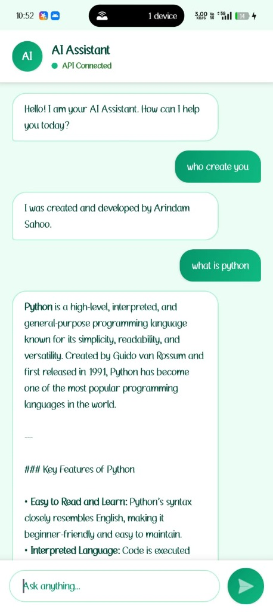

# 🤖 AIChatBot

A clean and simple native Android AI Chatbot app powered by **Google Gemini API**, built using **Kotlin**.

---

## 👨‍💻 Developer Info
- **Developer:** Arindam Sahoo
- **Task:** Task 5 (AI Chatbot Application)

---

## 📸 App Preview

  

---

## ✨ Features

- 💬 **Smart Chat:** Chat with Google Gemini AI in real time.
- 🎨 **Clean UI:** Simple chat interface with distinct user and bot message bubbles.
- 📝 **Markdown Support:** Clean text formatting (code blocks, bold, italic, bullet points).
- 🛡️ **Creator Recognition:** Recognizes queries like *"who created you"* and identifies **Arindam Sahoo** as the developer.
- 🔑 **Custom API Key:** Easily add or update your own Gemini API key inside the app.
- ⚡ **Smooth & Fast:** Uses Kotlin Coroutines for fast, background network requests.

---

## 🛠️ Tech Stack

- **Language:** Kotlin
- **UI:** Android XML + RecyclerView
- **AI Model:** Google Gemini API (`gemini-3.8-flash`, `gemini-3.5-flash`)
- **Network:** OkHttp 4 + Coroutines
- **Min SDK:** 24 (Android 7.0+)

---

## 🚀 How to Run

1. Open **Android Studio**.
2. Click **Open** and select this `AIChatBoot` folder.
3. Wait for Gradle sync to finish.
4. Run the app on an Android Emulator or a real device (`Shift + F10`).

---

## 🔑 How to Add Your API Key

1. Get a free API key from [Google AI Studio](https://aistudio.google.com/app/apikey).
2. Open the app and **long-press** the top header status text (**"API Connected"**).
3. Paste your key and click **Save**.

---

**Developed by Arindam Sahoo**
